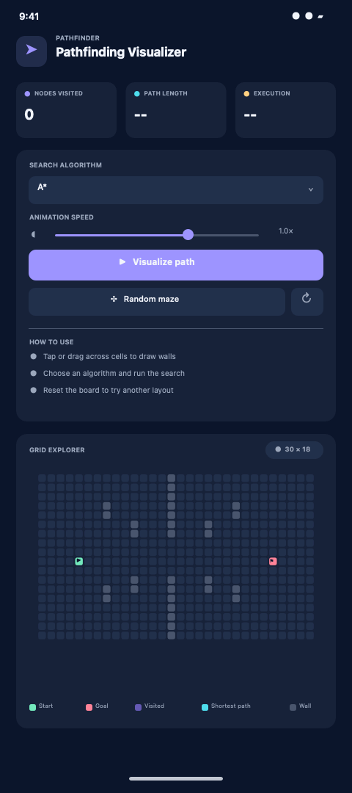

# Pathfinding Visualizer

An interactive, cross-platform Flutter application for exploring and comparing graph-search algorithms on an unweighted grid. Draw obstacles, select a search strategy, and watch the explored frontier and shortest path animate in real time.



## Features

- Visualize Breadth-First Search (BFS), Dijkstra's algorithm, and A*.
- Draw and erase obstacles directly on the grid, including by dragging.
- Generate a random obstacle layout with a guaranteed route between endpoints.
- Animate exploration and the final path, with pause, resume, and adjustable speed.
- Compare explored-node count, path length, and algorithm execution time.
- Responsive dark interface for Android, iOS, Web, macOS, Linux, and Windows.
- Runs locally without accounts, network access, or third-party runtime packages.

## Algorithms

The grid is an unweighted, four-connected graph: each cell connects to its valid north, east, south, and west neighbors, and every move has a cost of 1.

| Algorithm | Strategy | Completeness and optimality | Time complexity in this implementation |
| --- | --- | --- | --- |
| BFS | FIFO queue; explores by increasing distance | Complete and optimal for unit-cost edges | `O(V + E)` |
| Dijkstra | Expands the unsettled node with minimum known distance | Complete and optimal for non-negative edge costs | `O(V²)` |
| A* | Expands the node with minimum `g(n) + h(n)` | Complete and optimal with the Manhattan heuristic on this grid | `O(V²)` |

`V` is the number of traversable cells and `E` is the number of valid neighbor connections. The weighted searches use a linear scan to select the next frontier node; a binary heap would reduce their asymptotic search cost. All algorithms use the same deterministic neighbor order, making visual comparisons repeatable.

The A* heuristic is Manhattan distance, `|row₁ − row₂| + |column₁ − column₂|`. It is admissible and consistent for four-directional movement with unit edge costs.

## Getting started

### Requirements

- Flutter SDK with Dart `3.13.5` or later.
- A supported Flutter target. Install/configure its toolchain to run on a simulator, device, or desktop.

### Run locally

```bash
git clone https://github.com/<your-username>/pathfinding_visualizer.git
cd pathfinding_visualizer
flutter pub get
flutter run -d chrome
```

For a different target, list available devices with `flutter devices`, then run `flutter run -d <device-id>`.

### Controls

1. Click or drag across cells to add or remove walls.
2. Choose BFS, Dijkstra, or A* from the algorithm selector.
3. Adjust animation speed and select **Visualize path**.
4. Pause or resume the animation; use **Random maze** or the reset button to explore another board.

Start and goal cells are fixed in the current version. Wall placement is disabled while the animation is running.

## Project structure

```text
lib/
  main.dart          # Responsive UI, grid interactions, and animation
  pathfinding.dart   # Grid model and pure search algorithm implementation
test/
  pathfinding_test.dart
docs/
  demo.gif
```

## Validation

```bash
flutter analyze
flutter test
```

The algorithm tests cover shortest-path correctness, unreachable goals, start-equals-goal, and input validation.
GitHub Actions runs the analyzer and test suite for pushes and pull requests targeting `main`.

## Limitations

- The graph is unweighted and four-directional; diagonal movement and weighted terrain are not supported.
- Start and goal positions are fixed.
- Execution time measures the synchronous search computation on the current device; it is not a cross-device benchmark.
- Dijkstra and A* use a linear frontier scan to keep the implementation easy to inspect. This is suitable for the small demonstration grid, not a large-scale routing workload.

## References

- E. W. Dijkstra, “A note on two problems in connexion with graphs,” *Numerische Mathematik*, 1959.
- P. E. Hart, N. J. Nilsson, and B. Raphael, “A Formal Basis for the Heuristic Determination of Minimum Cost Paths,” *IEEE Transactions on Systems Science and Cybernetics*, 1968.
- T. H. Cormen et al., *Introduction to Algorithms*, 4th edition, MIT Press, 2022.

## License

This project is released under the MIT License. See [LICENSE](LICENSE).
